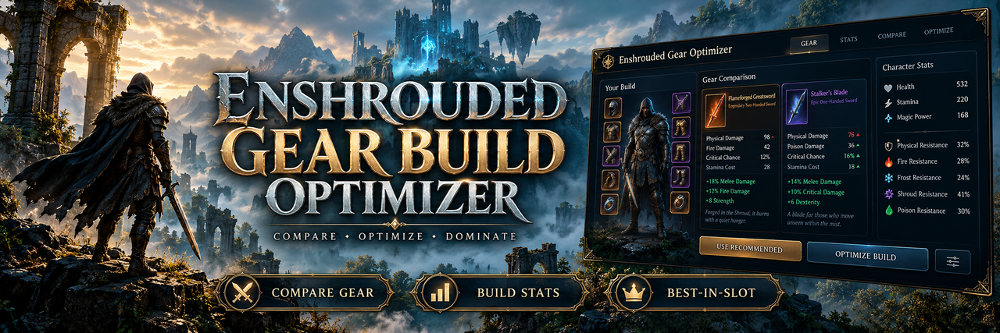

# ⚙️ Enshrouded Gear Build Optimizer — Loadout Crafting for Windows

  

---

Enshrouded Gear Build Optimizer is a Windows companion toolkit built for adventurers who would rather fight the fog than the inventory screen. It focuses on equipment comparison and character loadouts, giving you a clear read on how a new weapon or armor piece stacks up before you commit to the swap. The repository holds the documentation, project notes, and packaged release you need to get oriented. Treat it as a modder's workbench: inspect the contents, verify the build, and back up your data before you tinker.

## Features

- **Loadout Lab:** Sketch out full character builds and swap pieces between slots to see how the whole picture shifts — not just one weapon in isolation.
- **Side-by-Side Gear Duel:** Put two pieces of armor or weaponry head to head and watch the numbers settle the argument for you.
- **Stat Ledger:** Follow every point of damage, defense, and resistance across the gear you're considering, so nothing sneaks past your spreadsheet.
- **Build Profiles:** Save multiple loadout configurations for the same character and jump between them when the situation calls for a different approach.
- **Windows-Native Workflow:** A packaged companion built for PC players — unpack the folder, keep the bundled files together, and launch the included executable.
- **Release-Ready Packaging:** Distributed as a versioned ZIP with the executable and supporting files kept intentionally close to the documentation.

alternative open the tool, drag your candidates into the comparison view, and let the optimizer do the arguing while you decide what actually fits your playstyle. This is a modder's workbench first — expect the workflow to evolve alongside the project, and keep your own notes on what changes between releases. Back up your data before you start tinkering; even the most careful optimizer respects a good save.

## Installation

Before you can start crunching stat weights and arguing with yourself about whether that extra point of crit beats the flat armor roll, you'll need to actually get the optimizer onto your machine. Here's how to summon it without tripping over a single corrupted download.

**Step one: claim your package.** Head to the project's release area and grab the packaged ZIP. It's the tidy little bundle that contains everything the optimizer needs to breathe — no background downloads, no silent installers, no sneaky wizards judging your hardware. Just the release, sitting there, waiting.

**Step two: unpack with intent.** Extract the entire archive into a fresh folder of your choosing. Resist the urge to drag out just the executable and leave the rest behind — the bundled files, libraries, and configuration bits are a team, and splitting them up is how you get a lonely EXE that stares at the wall and refuses to work. Keep the family together.

**Step three: run a quick sanity check.** Before you double-click anything, take a moment to inspect what you've got. Verify the executable's origin, glance over your security tool's verdict, and make sure the folder looks like what the documentation describes. A sixty-second pause here saves a two-hour headache later. Trust the process, but verify the provenance.

**Step four: launch and start comparing.** With the files verified and the folder intact, fire up the executable. That's your entry point into equipment comparison and loadout tinkering — the whole reason you're here.

Two housekeeping notes from one modder to another. First, keep every file in the same directory as the executable; moving things around mid-session is a classic self-inflicted wound. Second, back up your Enshrouded save data before you start logging loadouts and swapping gear builds. The optimizer is a planning companion, but a backup is the real safety net. Once that's done, you're free to compare, plan, and optimize to your heart's content.

## Compatibility

This companion is built for the Windows adventurer braving the shroud, and it plays nicest with a Windows 10 or 11 setup running the current live Enshrouded build. The team develops and tests against the latest official Enshrouded release, so gear stats, affixes, and armor behaviors reflect the game as it exists right now — if the shroud shifts after a major update, expect a short window before those numbers are re-verified.

Already running other Enshrouded mods? No handshake required. The optimizer is a self-contained companion workspace and does not inject code into the game, patch game files, or demand a load order slot — it simply reads what you give it and stays a respectful neighbor to any loadout manager or inventory tool you already trust. If a mod does touch equipment definitions, keep the optimizer pointed at that version so its comparisons stay honest.

Save data and loadouts should always be treated as quest-critical loot: back up your saves before experimenting with profile swaps, server moves, or character respecs. Server-side configuration is outside the optimizer's scope, so keep multiplayer changes in the hands of whoever runs the world.

Enshrouded lives on Steam, and this project follows the game through its official updates. When the game moves, the optimizer adapts; when it stumbles, the issue tracker is the campfire to warm up at. If you're running an unusual setup, poke around, report what smokes, and we'll patch it in.

## Gallery

Every great build starts with a glance at the numbers — and that's exactly where this gallery lives. Think of these as snapshots from the workbench: side-by-side gear cards, stat deltas popping in green and red, loadout slots waiting to be filled. Whether you're a longtime tinkerer or a fresh-faced adventurer stepping out of the shroud, these views are here to show you what the optimizer is built to do.

- **The Comparison Bench** — two pieces of equipment squared off, stat by stat, so you can see the trade-offs at a glance instead of squinting at tooltips.
- **Loadout Racks** — your character's kit arranged like a proper armory shelf, ready to be swapped, tweaked, and saved.
- **Stat Spreads** — the numbers behind the numbers, laid out for the planners who like to know exactly what they're getting into.
- **Build Profiles** — preset arrangements that let you keep your favorite configurations on hand for whenever the mood (or the mob) strikes.

Modders and tinkerers, these are your canvases. Fork the layout, rework the panels, add your own comparison logic — the gallery is as much a starting point as it is a showcase. If you build something worth bragging about, we'd love to see it strut its stuff. Screens to come as the project grows; for now, imagination is the best preview.

## Credits

Every optimizer is a relay race. Someone figures out how to sift through gear tiers and stat rolls so the rest of us don't have to; someone else turns that into something we can actually run on our machines. Enshrouded Gear Build Optimizer exists because that baton got passed a few times.

**The tinkerers.** Projects like this start with a familiar feeling: standing at the inventory screen at two in the morning wondering whether the new chest piece is actually better or just *looks* better. The early conceptual work — the math of stat weighting, the rough idea of what "compare" should mean — set the kind of groundwork every gear junkie in the community immediately recognizes.

**The shapers.** Turning comparison logic into a coherent Windows companion took patience with layout, edge cases, and the unglamorous business of making sure two pieces of armor line up fairly. The workflow design — gear comparison, stat planning, build profiles — reflects the iterative feedback of players who actually run loadouts rather than just theorycraft them.

**The playtesters.** Every build profile, every layout tweak, every "wait, why is it showing this stat wrong?" came from people who use the tool the way it's meant to be used. Their questions sharpened the project more than any roadmap ever did.

**The namesake and the namesake's namesake.** Credit belongs to the wider Enshrouded community for keeping companion tooling alive and interesting, and to Keen Games for building a world worthy of optimization in the first place. No affiliation is claimed — just gratitude.

**Finally, you.** Anyone who opens the documentation, files a thoughtful issue, or shares how their loadout evolved after using the tool is part of the credit list too, whether they know it or not. The project keeps its momentum because players keep showing up.

Thanks for reading, and may your next comparison always favor you.

